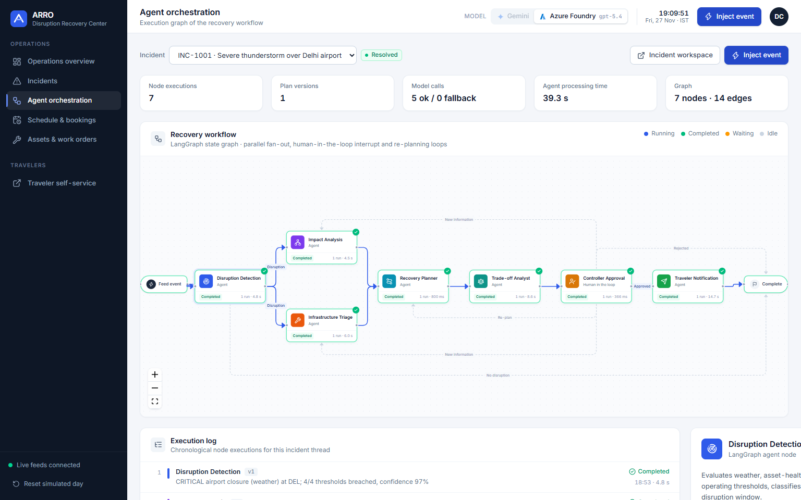
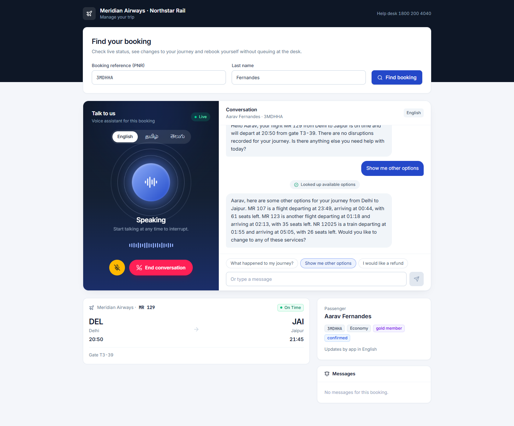

# ARRO – Disruption Recovery & Asset Response Orchestrator

A full-stack, multi-agent operations platform for a combined airline and rail network. It detects disruptions from weather and asset-health feeds, quantifies the cascading impact on services, crew and passengers, generates scored recovery options, waits for a duty controller's approval and then executes the plan and sends personalised traveler notifications with self-service rebooking.

| | |
|---|---|
| Backend | Python · FastAPI · LangGraph |
| Frontend | React · Vite · Tailwind CSS · React Flow |
| Language models | Switchable at runtime between Google Gemini and Azure AI Foundry (API key) |



## Capabilities

- **Detection** – threshold evaluation of weather (Open-Meteo, simulated fallback), signalling, track and aircraft telemetry with severity, confidence and disruption window.
- **Cascading impact** – delay propagation through aircraft and rake rotations, crew duty-time breaches, missed air/rail connections, priority passengers (wheelchair, unaccompanied minors, medical, loyalty tiers).
- **Recovery planning** – three strategies per disruption type (retime, cancel and consolidate, divert, tail swap, caution order, short-terminate with coach bridge, alternate mode), re-accommodation against seat inventory, reserve crew allocation and an INR cost model.
- **Trade-offs** – multi-criteria scoring by controller priority, confidence from repair-window uncertainty, P90 sensitivity and written rationale.
- **Controller in the loop** – approve, override with reason, reject, re-plan with new priorities or inject field updates (repair delayed / early, crew shortage, seat inventory drop) that loop the graph back.
- **Infrastructure triage** – automated work orders with team dispatch, parts, safety checklist and P50 / P90 repair windows.
- **Traveler notifications** – multilingual messages (English, Hindi, Marathi, Gujarati, Kannada, …) across app, SMS, WhatsApp and email, assisted-call queue and a self-service portal for rebooking or refunds.
- **Voice assistant for travelers** – Azure Speech Voice Live agent in the traveler portal. Travelers speak in English, Tamil or Telugu, hear natural neural voices, can interrupt, and the assistant can explain the disruption, search alternatives, rebook or start a refund after verbal confirmation.
- **Crowd monitor** – two looping camera feeds (`client/public/*.mp4`) stand in for the security checkpoints of Terminal 1. A frame is sent to the vision model every 20 s; people, queue length, density (people / m²) and estimated wait are stored in SQLite, smoothed with a rolling median, and turned into a rerouting plan (steer passengers to the shorter queue, open lanes) plus an advisory to passengers on at-risk departures. Counts are model estimates and the camera area, lanes and screening rates in `server/app/data/reference.py` are calibration assumptions.
- **Real-time flights** – AviationStack departures and arrivals for Chennai on the overview and crowd monitor, cached in SQLite to protect the metered quota.
- **Agent orchestration view** – live n8n-style canvas of the LangGraph workflow with per-node execution traces and model calls.

## Getting started

### Prerequisites

- Python 3.11+ and Node.js 20+

### 1. Configure

Create `.env` in the repository root (or `server/.env`) – see `server/.env.example`:

```env
LLM_PROVIDER=azure                     # or gemini
AZURE_FOUNDRY_ENDPOINT=https://<resource>.services.ai.azure.com/openai/v1
AZURE_FOUNDRY_API_KEY=<key>            # azure_api_key is also accepted
AZURE_FOUNDRY_DEPLOYMENT=<deployment name>
GEMINI_API_KEY=<key>
GEMINI_MODEL=gemini-2.5-flash

# Traveler voice assistant (Azure Speech Voice Live, API key auth)
AZURE_VOICELIVE_ENDPOINT=https://<resource>.services.ai.azure.com/
AZURE_VOICELIVE_API_VERSION=2025-10-01
AZURE_VOICELIVE_MODEL=gpt-4.1          # gpt-realtime is not available in every region
# AZURE_VOICELIVE_API_KEY=<key>        # optional; defaults to the Azure Foundry key

# Real e-mail / SMS to the four contact travelers (optional; otherwise recorded as not configured)
SMTP_HOST=smtp.gmail.com
SMTP_PORT=587
SMTP_USER=<gmail address>
SMTP_PASSWORD=<16-character Gmail app password>
SMS_PROVIDER=twilio                    # or fast2sms
TWILIO_ACCOUNT_SID=<sid>
TWILIO_AUTH_TOKEN=<token>
TWILIO_FROM=<twilio number>
# FAST2SMS_API_KEY=<key>

# Real-time flights (AviationStack) and the crowd monitor
AVIATIONSTACK_API_KEY=<key>            # free plan is metered; results are cached in SQLite for 15 min
# CROWD_FRAME_INTERVAL_SECONDS=20      # how often a camera frame is sent to the vision model
# DATABASE_PATH=                       # default server/data/arro.db
```

The network is centred on Chennai (MAA airport, Chennai Central and Egmore stations). Four real contact travelers (Vishwaa Yuvaraj, Lathifunisa Tausifa, Amal Sivan, Sushmitha Saravanan) hold a booking on **every flight** (original references VSHWA1, TAUSF2, AMALS3, SUSHM4; the booking on flight MR 101 is VSH101, TAU101, AMA101, SUS101, and so on), so any disruption finds them on the manifest. When the controller approves a plan every affected booking gets a notification record, but the real e-mail and SMS are sent once per person for their soonest affected flight, so four people do not receive dozens of messages. **Resend** on any other record sends it by hand. **Overview → Real e-mail & SMS delivery** shows the provider status and has a test-send button.

At least one provider is needed for model-written narratives; without any, every agent falls back to deterministic output and the workflow still completes.

### 2. Backend

```powershell
python -m venv venv
venv\Scripts\pip install -r server\requirements.txt
cd server
..\venv\Scripts\python -m uvicorn app.main:app --port 8000 --reload --timeout-graceful-shutdown 2
```

API docs: http://localhost:8000/docs

### 3. Frontend

```powershell
cd client
npm install
npm run dev
```

Open http://localhost:5173 for the landing page; **Log in** goes straight to the control center at `/overview` (there are no credentials, it is a demo). The traveler portal is at http://localhost:5173/traveler (links in notifications prefill the PNR and last name).

### 4. Demo walkthrough

1. Click **Inject event** and choose a scenario (for example *Severe thunderstorm over Chennai airport*).
2. Watch the agents run on **Agent orchestration**.
3. Open the incident, review impact, the work order and the three recovery options.
4. Optionally push a field update or re-plan with a different priority, then approve.
5. Review traveler notifications and open a self-service link to rebook as a passenger.
6. In the traveler portal, press **Start conversation**, allow the microphone, choose English, Tamil or Telugu and talk to the voice assistant (or type). Microphone access needs `localhost` or HTTPS.



### Smoke test

```powershell
cd server
..\venv\Scripts\python -m tests.smoke_test          # deterministic, all scenarios
..\venv\Scripts\python -m tests.smoke_test --llm    # with the configured model
```

## Documentation

- [System architecture](docs/ARCHITECTURE.md)
- [Flow charts](docs/FLOWCHART.md)
- [Module descriptions](docs/MODULES.md)
- [API reference](docs/API.md)

---

# Project Execution Plan

## Prerequisites
- Clone this GitHub repository to your local machine.
- Complete the initial setup and ensure all dependencies are installed.

---

## Initial 1 Hour

| Team Member | Responsibility |
|------------|---------------|
| **Sushmitha** | Work on the PowerPoint presentation (PPT). |
| **Amal** | Work on the PPT and create flowcharts and system architecture diagrams. |
| **Vishwaa** | Develop the initial prototype. |
| **Tausifa** | Gather additional details and research on the selected topic. |

### Next Step
Once the initial prototype is completed, it will be pushed to the GitHub repository. All team members should pull the latest changes to their local environments before proceeding with the next phase.

---

## After Initial Prototype Completion

| Team Member | Responsibility |
|------------|---------------|
| **Vishwaa** | Research and analyze the selected topic in greater detail. |
| **Tausifa** | Work on the UI development and enhancements. |
| **Sushmitha** | Continue working on the PPT and project documentation. |
| **Amal** | Implement additional features and improvements. |

---

## Collaboration Guidelines
- Regularly pull the latest changes from the repository.
- Commit code and documentation updates frequently.
- Keep the team informed of progress and blockers.
- Coordinate changes to avoid merge conflicts.
