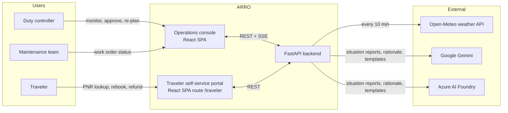
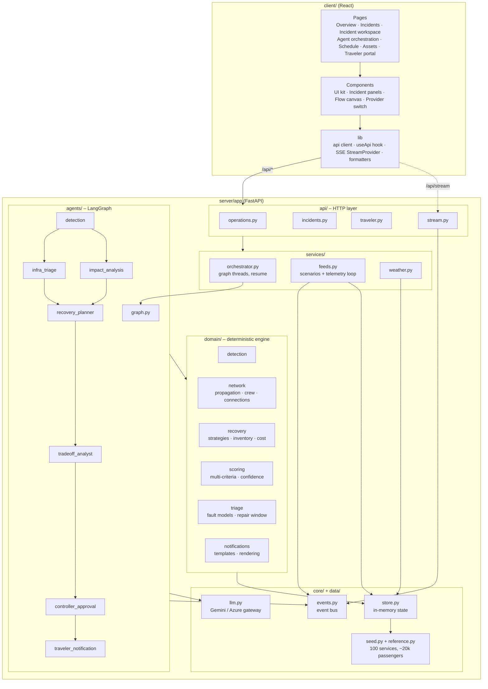
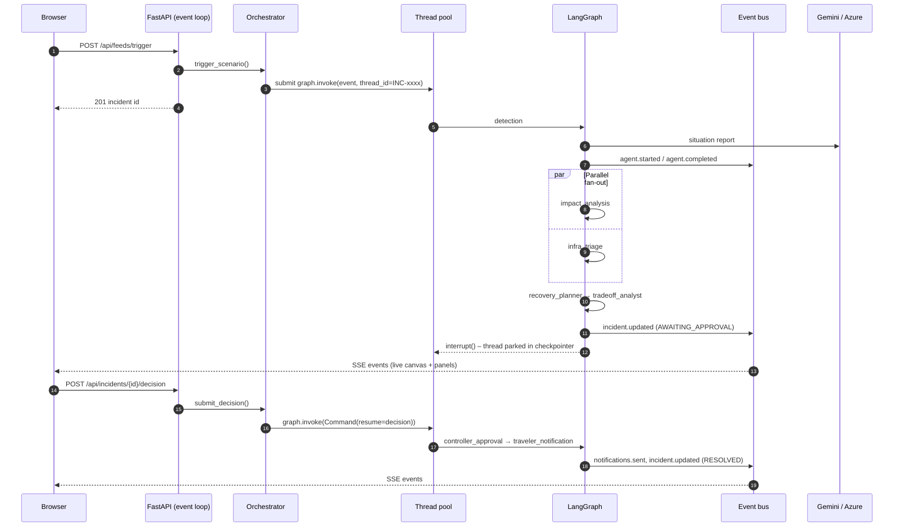
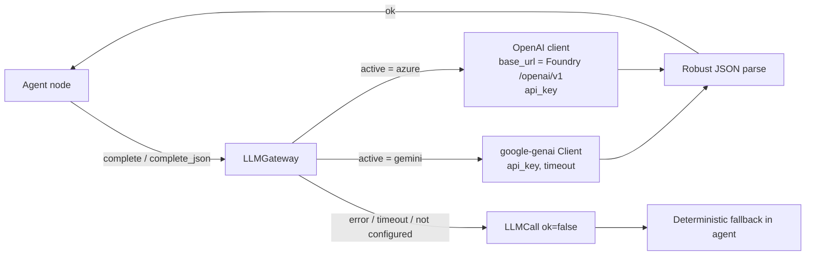
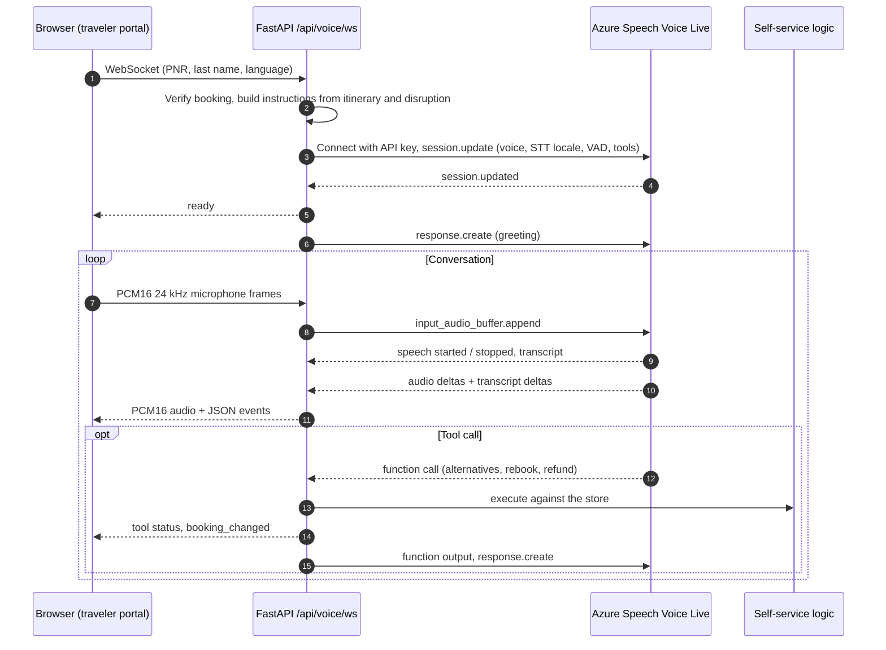
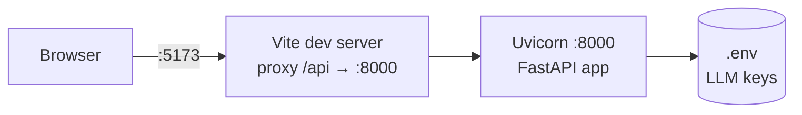

# ARRO – System Architecture

ARRO (Asset Response & Recovery Orchestrator) detects disruptions across a combined airline and rail network, quantifies the cascading impact, generates and scores recovery plans, waits for a duty controller's decision and then executes the plan and notifies every affected traveler.

## 1. Technology stack

| Layer | Technology |
|---|---|
| Frontend | React 19, Vite 8, Tailwind CSS v4, React Router, React Flow (`@xyflow/react`), Recharts, Lucide icons |
| Backend API | Python 3.14, FastAPI, Uvicorn, Pydantic v2, Server-Sent Events |
| Agent orchestration | LangGraph `StateGraph` with `InMemorySaver` checkpointer, `interrupt()` / `Command` for human-in-the-loop |
| Language models | Switchable at runtime: Google Gemini (`google-genai`, API key) or Azure AI Foundry (OpenAI v1 Responses API, API key – no `DefaultAzureCredential`) |
| External data | Open-Meteo public weather API (simulated fallback when unreachable); simulated asset-health and operations telemetry |

## 2. System context

## 3. Logical architecture

### Design principles

- **Deterministic core, language model at the edges.** All operational numbers (delays, crew legality, seat allocation, costs, scores, confidence) are computed by the `domain/` engine. The language model writes situation reports, impact narratives, work-order descriptions, trade-off rationale and multilingual message templates. Every model call has a deterministic fallback, so the workflow completes even if the model is unavailable, and the UI shows which provider produced each artefact.
- **Controller in the loop.** The graph pauses at `controller_approval` using LangGraph `interrupt()`. Nothing is written to the operational schedule or sent to travelers until the controller approves.
- **Dynamic re-planning.** From the approval gate the controller can re-plan with different priorities (loop back to `recovery_planner`) or inject new field information (loop back to `impact_analysis` + `infra_triage` or to `recovery_planner`). Each loop increments the plan version and is kept in the plan history.
- **Live by default.** Every agent start/finish, incident change, feed event and work-order change is published on the event bus and pushed to the browser over SSE, so all screens update without polling.

## 4. Runtime and concurrency

- Graph runs execute on a `ThreadPoolExecutor` so long model calls never block the FastAPI event loop.
- Each incident is a LangGraph thread (`thread_id = incident id`); the `InMemorySaver` checkpointer stores state between the interrupt and the controller's decision.
- The in-memory `Store` is guarded by a re-entrant lock; the `EventBus` is a thread-safe ring buffer that the SSE endpoint tails.
- Background tasks started in the FastAPI lifespan: the telemetry loop (asset, operations and weather ticks every 6 s) and the weather refresh (every 10 min).

## 5. Language-model gateway

- The active provider is switched from the top bar (`PUT /api/settings/llm`); providers without credentials are disabled in the switch.
- Every call is recorded as an `LLMCall` (provider, model, latency, purpose, error) and attached to the agent execution so the Orchestration page can show it.

## 5a. Traveler voice assistant

- The Azure key stays on the server; the browser only talks to the backend WebSocket.
- Speech recognition uses `azure-speech` with the selected locale (`en-IN`, `ta-IN`, `te-IN`) and speech output uses Azure neural voices for the same locales.
- Barge-in: when the caller starts speaking the server cancels the active response and the browser stops queued playback.
- Booking changes require verbal confirmation (enforced in the assistant instructions) and use the same functions as the portal buttons.
- The model is configurable (`AZURE_VOICELIVE_MODEL`); audio-native `gpt-realtime` is not available in every Azure region, so a text model with Voice Live speech services (default `gpt-4.1`) is used.

## 6. Data model (in-memory)

| Collection | Contents |
|---|---|
| `trips` | 70 flights + 30 trains with schedule, vehicle, rotation, crew pairing, delay / cancellation / diversion state |
| `rotations` | Ordered trip chain per aircraft tail / rail rake |
| `pairings`, `reserves` | Crew pairings with duty-time limits; reserve crew per base |
| `passengers`, `pax_by_trip`, `pnr_index` | ~19,900 passengers with multi-leg itineraries (air-air, air-rail, rail-air), tier, special-service requests, language and channel |
| `assets`, `teams` | Infrastructure assets with live telemetry and baseline; maintenance teams with skills and ETA |
| `incidents` | Incident record: event, detection, impact, infra, options, recommendation, decision, notifications, trace, plan history |
| `work_orders`, `notifications`, `feed` | Work orders with repair windows, traveler messages, live feed |

## 7. Deployment

For production, `npm run build` produces static assets in `client/dist` that can be served by any CDN or reverse proxy (Nginx, Azure Static Web Apps), with `/api` routed to Uvicorn workers behind the proxy. Persistent stores (PostgreSQL for operational data, Redis for the event bus, `langgraph-checkpoint-postgres` for graph state) are drop-in replacements for the in-memory components.
