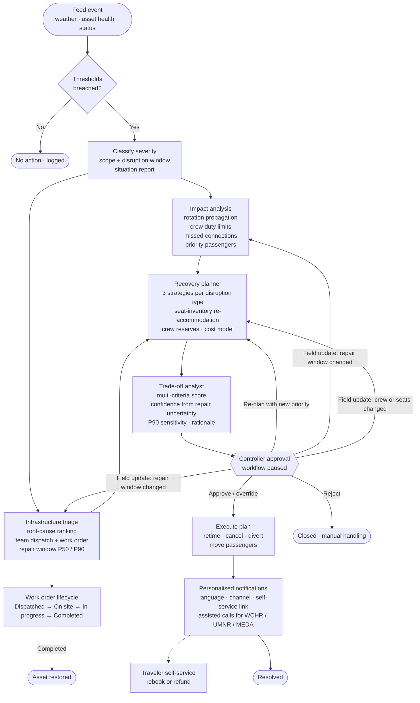
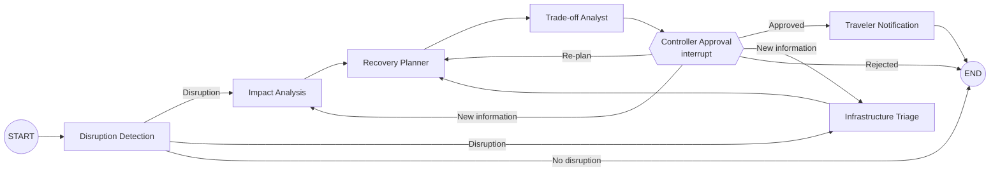
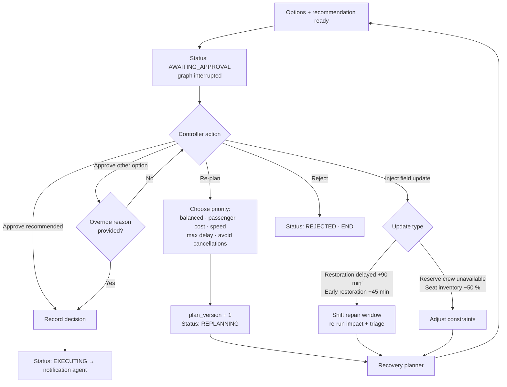
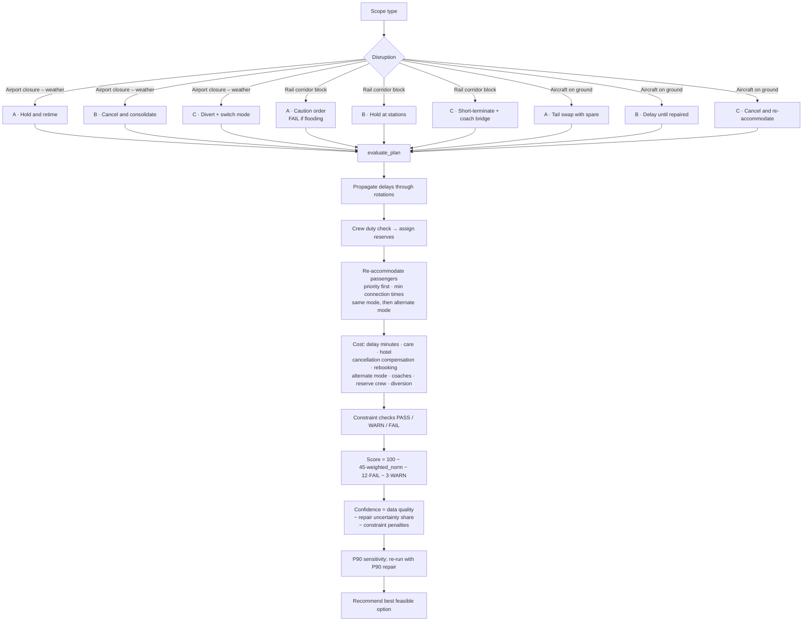
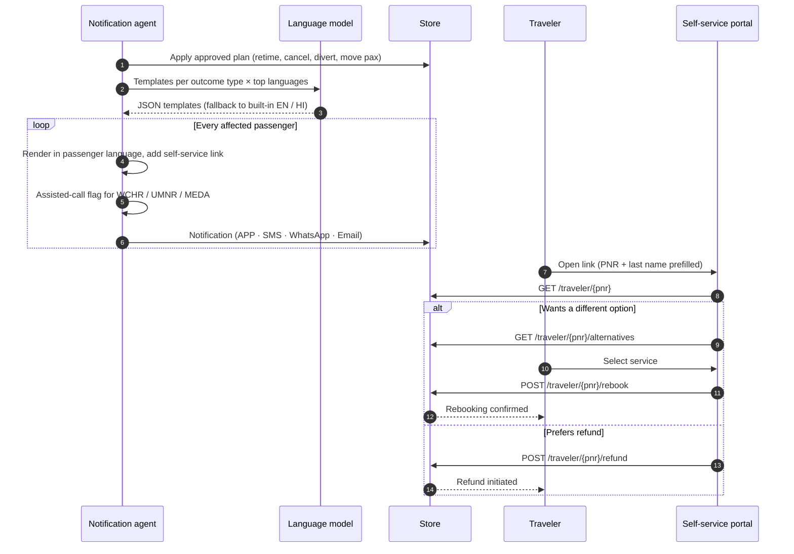
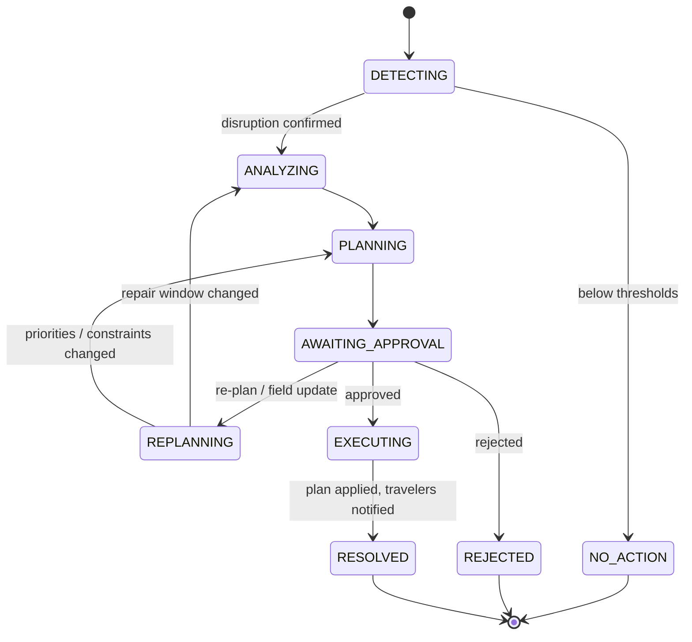

# ARRO – Flow Charts

## 1. End-to-end incident lifecycle

## 2. LangGraph agent graph

This is the exact graph compiled in `server/app/agents/graph.py` and rendered live on the **Agent orchestration** page.

| Edge type | Mechanism |
|---|---|
| Parallel fan-out after detection | Conditional edge returning `["impact_analysis", "infra_triage"]`; LangGraph runs both in the same super-step and joins at `recovery_planner` |
| Human-in-the-loop | `interrupt()` inside `controller_approval`; resumed by `Command(resume=decision)` from `POST /incidents/{id}/decision` or `/updates` |
| Re-plan and re-assess loops | `Command(goto=...)` from `controller_approval`, declared with `destinations=` so the loops appear in the exported graph |

## 3. Controller approval decision flow

## 4. Recovery option generation and scoring

## 5. Traveler notification and self-service flow

## 6. Incident status state machine

